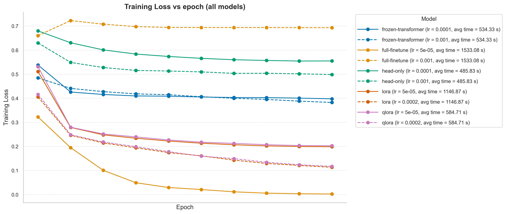
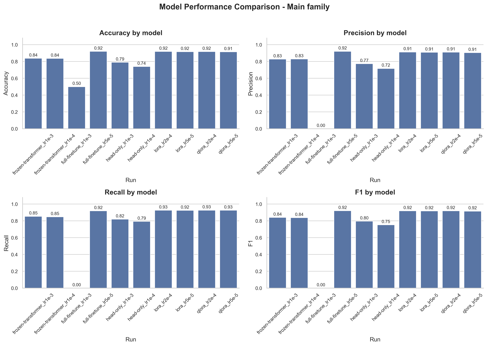
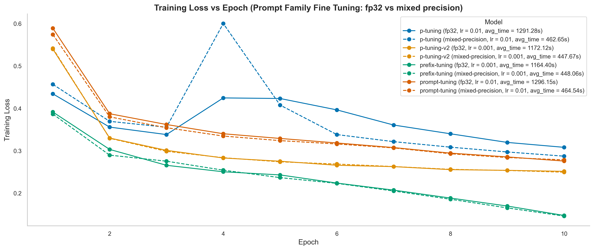

# BERT-IMDB Sentiment — A Head-to-Head Study of 9 Fine-Tuning Strategies

**Author:** Anubhav Joshi

**Base model:** `bert-base-uncased` (110M parameters).

**Dataset:** IMDB (25k train / 25k test, untouched)

**Stack:** PyTorch, Hugging Face `transformers` / `datasets` / `peft`, bitsandbytes (QLoRA), Apple Silicon (MPS) + CUDA

## Analyses

1. **Learning rates and fine-tuning methods** — Compare learning-rate runs across full fine-tuning, frozen and head-only approaches, LoRA/QLoRA, and prompt methods (prompt tuning, prefix tuning, P-tuning, and P-tuning v2). Results include accuracy, precision, recall, F1, confusion matrices, and loss curves.
2. **Mixed precision** — Compare full-precision and bfloat16 mixed-precision training for prompt-family methods. In the saved runs, mixed precision reduced training time by roughly 2.6–2.8× per epoch while producing similar loss curves and test metrics. Timings depend on hardware.

## Results







Additional plots and per-run metrics are in [`results/figures`](results/figures/) and [`results/metrics`](results/metrics/).

## Project Structure
```txt
 bert-imdb-sentiment/
 ├── README.md
 ├── requirements.txt
 ├── configs/
 │ ├── frozen.yaml
 │ ├── full_finetune.yaml
 │ ├── lora.yaml
 │ └── qlora.yaml
 ├── src/
 │ ├── data.py          # load IMDB, tokenize, build DataLoaders (shared, untouched test set)
 │ ├── models.py        # build model per strategy: frozen head / full FT / LoRA / QLoRA
 │ ├── train.py         # training loop, takes a config, saves checkpoint + metrics
 │ ├── evaluate.py      # runs a saved model (or the raw pretrained model) on the test set ->
 accuracy, F1, confusion matrix
 │ └── utils.py         # seeding, device selection (mps/cuda/cpu), logging helpers
 ├── scripts/
 │ ├── run_train.py         # CLI: python scripts/run_train.py --config configs/lora.yaml
 │ └── run_eval.py          # CLI: python scripts/run_eval.py --checkpoint
 ├── notebooks/
 │ ├── 01_download_and_explore.ipynb    #
 │ └── 02_compare_results.ipynb          # loads all saved metrics, builds final comparison
 table/plots
 ├── results/
 │ ├── metrics/                     # one JSON per run: {strategy, lr, accuracy, f1, confusion_matrix,
 ...}
 │ └── checkpoints/                 # saved fine-tuned weights (gitignored — large files)
 └── tests/
 └── test_data.py                   # sanity checks on tokenization/splits
```


## Run

Install the dependencies:

```bash
pip install -r requirements.txt
```

Run a configured experiment:
```bash
python scripts/run_train.py --config configs/prompt-tuning.yaml
```

Override the learning rate or precision if needed:
```bash
python scripts/run_train.py --config configs/prompt-tuning.yaml --learning_rate 0.01 --precision mixed-precision
```
